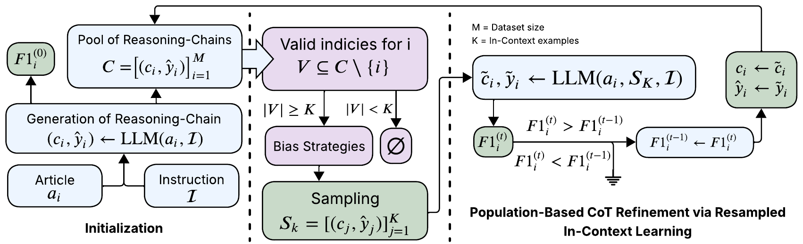

# INDI-PROPspan & ReCoT

This repository will host the INDI-PROPspan dataset along with the implementation of the ReCoT framework, as introduced in our paper:

📄 Paper: [*Reasoning for Propaganda Detection via Label-Guided CoT Optimisation*](https://arxiv.org/abs/2610.17271)  
📅 Accepted at: Findings of the European Chapter of the Association for Computational Linguistics (EACL)  
🚧 The code and dataset will be added soon.

## Overview

INDI-PROPspan extends the INDI-PROP dataset ([Afroz et al., LREC 2026](https://github.com/flamenlp/INDI-Prop)) with span-level annotations of persuasion techniques in Indian news media. The resource is built around two major socio-political events:

1. CAA/NRC

2. Farmers' Protest

Each article is annotated at the span level to capture:

1. Propagandistic text spans

2. The persuasion technique used in each span (20 techniques)

This enables explainable, technique-conditioned span-level propaganda detection in a non-Western socio-political setting.

## Dataset Statistics

| Component | Count |
|----------|------|
| Total Articles | 1,266 |
| Events Covered | 2 |
| Annotated Propaganda Spans | 3,922 |
| Fine-Grain Persuasion Techniques Categories | 20 |
| Inter-Annotator Agreement | 0.63 |

## Framework

We introduce ReCoT, a reasoning-conditioned detection framework in which span extraction is directly conditioned on Chain-of-Thought (CoT) reasoning.

<p align="center">
  
</p>

ReCoT first generates a pool of zero-shot CoT–prediction pairs. It then samples K examples from this pool using a performance-guided bias strategy (I-Bias, J-Bias, or Random) and refines the CoTs through population-based refinement, accepting a refined CoT only if its $F1_{LCS}$ improves. This captures the definitional cues of persuasive techniques without requiring additional explanation annotations. On INDI-PROPspan, ReCoT reaches a macro $F1_{LCS}$ of 0.364 (88% of the SFT upper bound), and on PTC it reaches 85% of the SFT upper bound.

## Dataset Access

The dataset will be made available for research purposes only.

The access request form will be added soon.

## Usage Policy

By requesting access, you will agree to:

- Use the dataset strictly for academic or research purposes.

- Do not use it for political targeting, profiling, or manipulation.

- Cite the original paper in any published work.

The data reflects real-world political discourse and may contain ideological or sensitive content.
Users are encouraged to interpret and use it responsibly.

👉 The dataset will be released to support transparency and computational media analysis.

## Citation

If you use this dataset or framework, please cite (full citation details will be updated after the proceedings are published):

```bibtex
@misc{afroz2026reasoningpropagandadetectionlabelguided,
      title={Reasoning for Propaganda Detection via Label-Guided CoT Optimisation}, 
      author={Zeba Afroz and Harsh Vardhan and Md. Shad Akhtar},
      year={2026},
      eprint={2610.17271},
      archivePrefix={arXiv},
      primaryClass={cs.AI},
      url={https://arxiv.org/abs/2610.17271}, 
}
```

Please also cite the original INDI-PROP dataset:

```bibtex
@inproceedings{afroz-etal-2026-fine,
  title = {Fine-grained Narrative Classification in Biased News Articles},
  author = {Afroz, Zeba and Vardhan, Harsh and Bhakuni, Pawan and Punia, Aanchal and Kumar, Rajdeep and Akhtar, Md. Shad},
  booktitle = {Proceedings of the Fifteenth Language Resources and Evaluation Conference (LREC 2026)},
  month = {May},
  year = {2026},
  pages = {8431--8445},
  address = {Palma, Mallorca, Spain},
  publisher = {European Language Resources Association (ELRA)},
  doi = {10.63317/2ddvvr4zijyh}
}
```

## Contact

For questions or collaborations:

- **Zeba Afroz** — [zebaa@iiitd.ac.in](mailto:zebaa@iiitd.ac.in)
- **Harsh Vardhan** — [harsh25001@iiitd.ac.in](mailto:harsh25001@iiitd.ac.in)
- **Md. Shad Akhtar** — [shad.akhtar@iiitd.ac.in](mailto:shad.akhtar@iiitd.ac.in)
